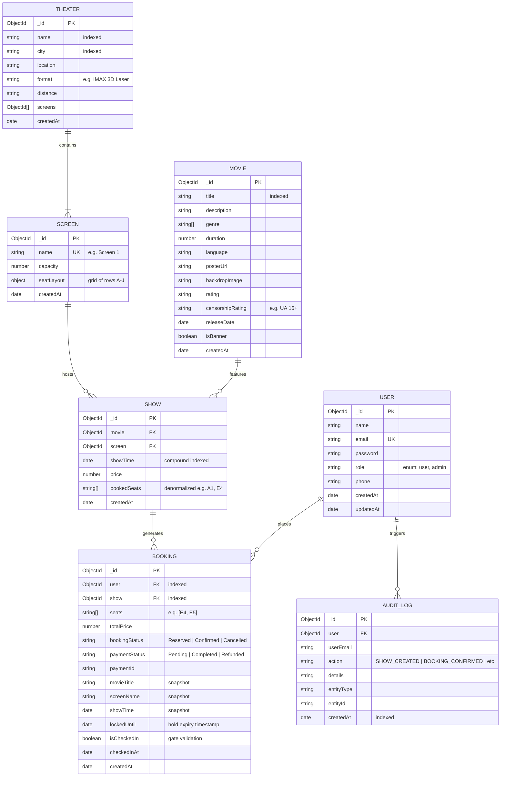
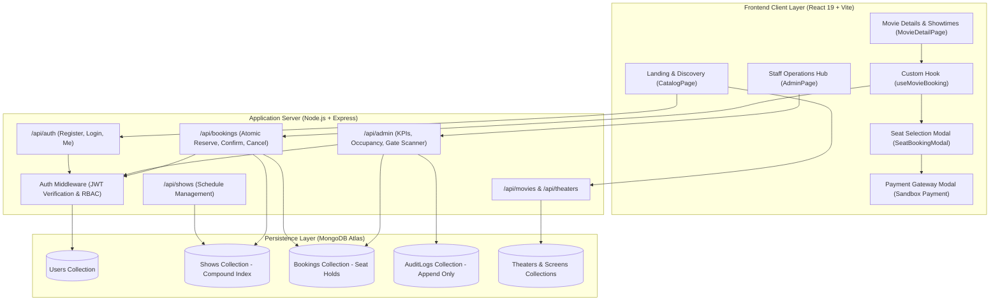
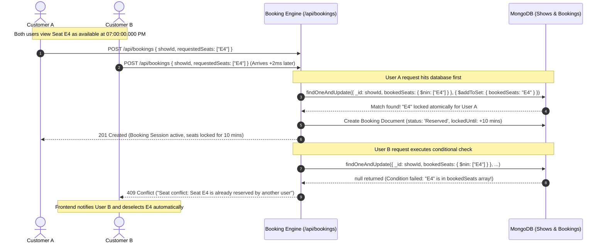
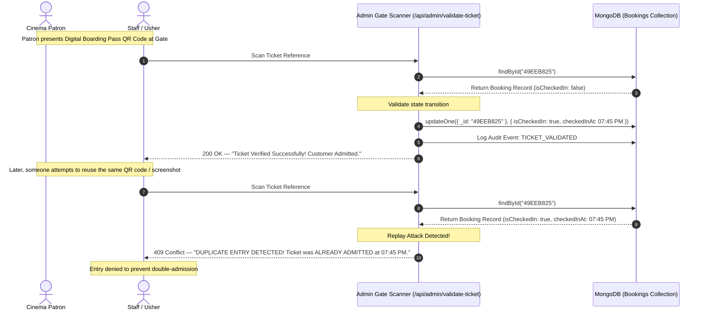
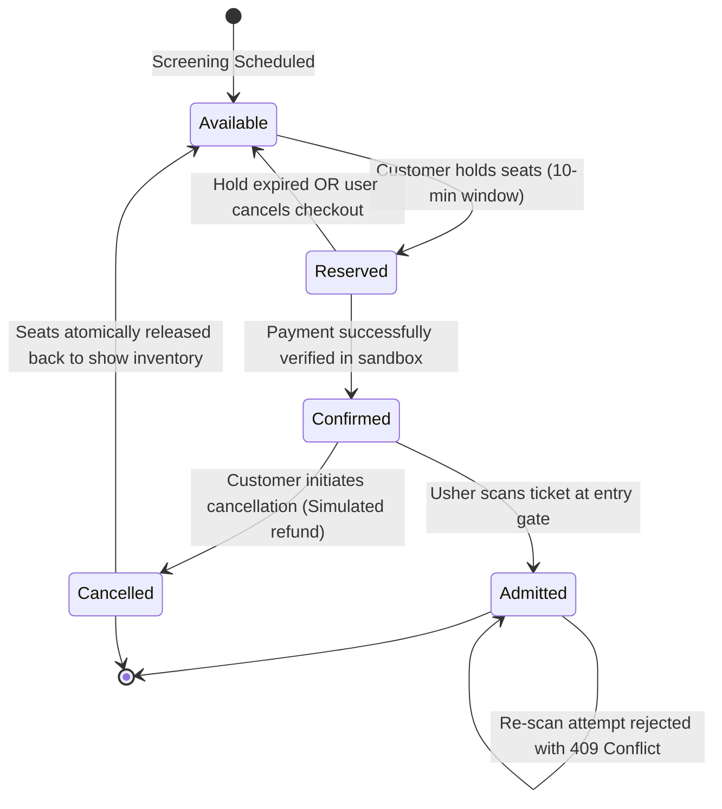

# PIXORA System Diagrams: Architecture, Data Models & Workflows

This document contains Mermaid visual diagrams illustrating the data architecture, entity relationships, concurrency flows, and gate security lifecycle of PIXORA.

---

## 1. Entity-Relationship (ER) Diagram

---

## 2. High-Level System Architecture Diagram

---

## 3. High-Concurrency Seat Reservation & Race-Condition Sequence

---

## 4. Single-Entry Gate Validation & Replay Defense Sequence

---

## 5. Booking State Lifecycle Diagram

